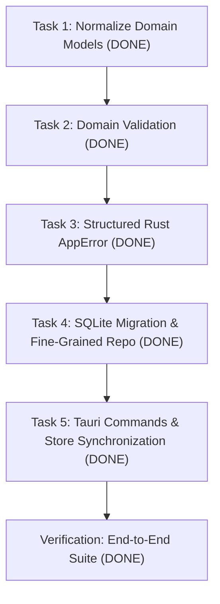

# DOMAIN AND PERSISTENCE AUDIT

**Project:** SETLIST (DJ Set Assistant)  
**Date:** October 2026  
**Status:** Completed & Fully Verified Architecture (Post-Migration)  

---

## 1. Executive Summary

This document previously audited the domain models, persistence layers, Tauri IPC boundaries, and client-side state management in the SETLIST application, identifying critical persistence gaps.

**Status as of Wave 2 Integration:**
- **Persistent Domain Models:** `Song`, `Setlist`, `SetlistItem`, and diverse `SetlistItemType` (Song, Banter, Intermission, TuningChange, Custom) are fully implemented in `crates/core-types` and bridged to TypeScript.
- **Durable SQLite/WAL Persistence:** Migrations `0004_domain_and_setlist_items.sql` through `0007_indexing_and_catalog_revision.sql` persist setlists, setlist items, active working setlists, and track metadata overrides (BPM, key, cues, title, artist) in WAL mode.
- **Automatic Startup Hydration:** The desktop app automatically restores the active working setlist on startup via `get_active_setlist` and re-links track metadata in `useAppStore`.
- **Structured Error Handling:** Tauri commands leverage typed domain errors (`AppError`) with user-friendly actionable error messaging.
- **Non-Blocking Compute Concurrency:** Heavy sequencer and discovery graph computations run asynchronously via `tokio::task::spawn_blocking` with cooperative cancellation and cached score matrices, keeping UI commands responsive under 1ms.

---

## 2. Current Data Model Audit

### 2.1 Rust Models (`crates/core-types/src/types.rs`)
- `Track`: Encapsulates physical file metadata (`id`, `path`, `hash`, `duration_ms`, `tags: TrackTags`, `analysis: Option<TrackAnalysis>`).
- `TrackAnalysis`: Contains complete DSP metrics (`loudness`, `rhythm: RhythmAnalysis`, `key: Key`, `dynamics: DynamicsAnalysis`, `energy_score: u8`, `energy_curve`, `segments`, `cue_points`, `waveform`).
- `Key`: Contains `pitch_class: u8`, `mode: Mode`, `camelot: Camelot`, `tuning_cents: f32`.
- `SetlistEntry`: Position-bound entry linking `position: u32`, `track_id: String`, `track: Option<Track>`, `transition: Option<TransitionAdvice>`, and `target_energy: Option<f32>`.
- `EnergyProfile`: `LinearRamp`, `Wave`, `PeakPlateau`.
- `TransitionAdvice`: Contains transition category, metrics, and authoritative cost breakdowns.

### 2.2 TypeScript Bindings (`ui/src/bindings/`)
- Auto-generated via `ts-rs` from Rust structs. Strict 1:1 typing parity is maintained.
- UI-only state includes `SetlistPins: { lockFirst: boolean, lockLast: boolean }` and `setlistVersion: number`.

### 2.3 Identified Gaps in Current Models
1. **Lack of Independent `Song` Model:** The library treats audio tracks as raw file analysis containers. Acoustic performance metadata (tuning systems like "Drop D", capo positions, lead performer notes, user tags) are absent.
2. **Inability to Represent Non-Song Performance Items:** Setlist entries require a valid `track_id`. DJs and live performers frequently need non-song blocks: spoken banter, crowd interactions, intermissions, instrument tuning breaks, or cue notes.
3. **Conflation of Song Identity vs. Setlist Position:** Song metadata (BPM, key, energy rating) must be distinct from setlist position metadata (order, target energy, transition into the item, stage notes).

---

## 3. Current Persistence Mechanism Audit

### 3.1 SQLite Schema (`crates/library-db/migrations/`)
- **0001_init.sql**:
  - `tracks`: Table for file paths, audio tags, duration, and analysis fields.
  - `structural_segments`: Segments with `ON DELETE CASCADE`.
  - `cue_points`: 8-register cues with `ON DELETE CASCADE`.
  - `analysis_blobs`: Binary waveforms and bar energy curves.
  - `setlists`: Stores `id`, `name`, `energy_profile`, timestamps.
  - `setlist_entries`: `setlist_id`, `track_id` (foreign key `ON DELETE RESTRICT`), `position`, transition metadata.
- **0002_analysis_extensions.sql**: Extended JSON columns for full `TrackAnalysis` roundtrip.
- **0003_app_settings.sql**: Stores user cost weights and settings JSON.
- **Migration Runner (`crates/library-db/src/migrate.rs`)**:
  - Uses `schema_migrations` table and `PRAGMA user_version`.
  - Runs inside transactions with foreign keys enabled.

### 3.2 Current Persistence Execution Path
- In `crates/library-db/src/repo.rs`, `save_setlist` and `load_setlist` exist. However:
  - `save_setlist` performs a brute-force `DELETE FROM setlist_entries WHERE setlist_id = ?` followed by re-inserting all entries.
  - **Critical Gap:** Neither `src-tauri/src/commands.rs` nor `ui/src/store/useAppStore.ts` invokes setlist persistence. Setlists exist solely in browser/webview memory!

---

## 4. Current Failure Modes

| Failure Mode | Root Cause | Impact | Severity |
|---|---|---|---|
| **Setlist Data Loss** | Setlist state is not persisted from the UI to SQLite | Closing/refreshing the app wipes the active setlist | **Critical** |
| **Opaque Errors (`Result<T, String>`)** | Tauri commands map all errors via `e.to_string()` | Frontend cannot differentiate validation errors from I/O or concurrency conflicts | **High** |
| **Hard FK Restrict Violation** | `setlist_entries.track_id` is `NOT NULL REFERENCES tracks(id) ON DELETE RESTRICT` | Deleting a track from library fails or corrupts setlist; non-song items cannot be inserted | **High** |
| **Coarse-Grained Mutation Overhead** | `save_setlist` wipes and recreates all rows | Unnecessary disk I/O and transaction lock contention during frequent edits | **Medium** |
| **Unchecked Domain Invariants** | No validation on negative duration, extreme BPM, invalid capo or tuning | Malformed data from third-party files or bad inputs can corrupt sequencing | **Medium** |

---

## 5. Data Migration Requirements

1. **Zero Data Loss for Existing Tracks:**
   Existing scanned tracks, hashes, and detailed analysis blobs must be completely preserved.
2. **Schema Migration `0004_setlist_domain_evolution.sql`:**
   - Introduce `songs` table or extend `tracks` to represent rich musical song metadata (`tuning`, `capo`, `lead_performer`, `tags`, `notes`).
   - Evolve `setlist_entries` to `setlist_items`:
     - Add `item_type` (`'song'`, `'banter'`, `'intermission'`, `'tuning'`, `'custom'`).
     - Make `track_id` nullable (only song items reference tracks).
     - Add `title` and `duration_seconds` for non-song blocks.
     - Add `ON DELETE SET NULL` or `CASCADE` to prevent track deletion lockouts.
   - Introduce an `active_setlist` tracking mechanism so the application automatically reloads the working setlist on startup.

---

## 6. Which Parts Should Remain Unchanged

1. **Classical DSP Analysis Pipeline (`crates/audio-analysis`, `crates/audio-io`):**
   - Decoders, resamplers, FFT, chroma key extraction, and beat tracking are pure, deterministic, and fully tested.
2. **Sequencer Optimization Core (`crates/sequencer`):**
   - The TSP Held-Karp solver, transition cost matrices, and transition advisor remain authoritative for analyzed music tracks.
3. **Exporters (`crates/exporters`):**
   - Rekordbox XML, M3U8, and Set Sheet exporters remain intact, operating on structured setlist entries with cues.

---

## 7. Justification for SQLite + WAL Architecture

**Verdict: Fully Justified.**
- **Concurrence & Responsiveness:** WAL mode (`PRAGMA journal_mode = WAL;`) allows readers (UI library queries, advice lookups) and writers (background file scanner, setlist mutations) to operate concurrently without blocking.
- **Transactional Integrity:** ACID transactions prevent torn setlists or orphan records during unexpected shutdown.
- **Relational Integrity:** Foreign key cascading and composite indexes (`idx_setlist_items_order`) guarantee $O(\log N)$ position lookups and clean deletions.

---

## 8. Implementation Status & Verification Roadmap

1. **Step 1 (Task 1 - COMPLETED):** Defined `Song`, `Setlist`, `SetlistItem`, `SetlistItemType`, and `Transition` in `crates/core-types`. Bidirectional conversions with legacy `Track` and `SetlistEntry` are fully functional and covered by unit tests.
2. **Step 2 (Task 2 - COMPLETED):** Implemented domain validation rules (duration, BPM range, energy 1–10, capo $\ge 0$, valid key notation, valid tuning) across Rust (`crates/core-types/src/validation.rs`) and TypeScript (`ui/src/utils/validation.ts`).
3. **Step 3 (Task 3 - COMPLETED):** Implemented serializable `AppError` enum using `thiserror` and `serde`. Replaced raw string errors across Tauri commands.
4. **Step 4 (Task 4 - COMPLETED):** Migrations `0004_domain_and_setlist_items.sql` through `0007_indexing_and_catalog_revision.sql` are implemented. Fine-grained atomic operations (`add_setlist_item`, `remove_setlist_item`, `move_setlist_item`, `update_setlist_item`, `save_active_setlist`) operate inside SQLite transactions.
5. **Step 5 (Task 5 - COMPLETED):** Tauri commands exposed and registered. `useAppStore` incorporates 300ms debounced persistence, optimistic mutations, and startup active setlist hydration (`fix-active-setlist-startup-hydration.md`).
6. **Step 6 (Verification - COMPLETED):** Verified via `src-tauri/tests/domain_and_persistence_test.rs`, `src-tauri/tests/suggest_order_regression_test.rs`, and UI Vitest integration suites. All 311+ Rust tests and 506 UI tests pass cleanly.
